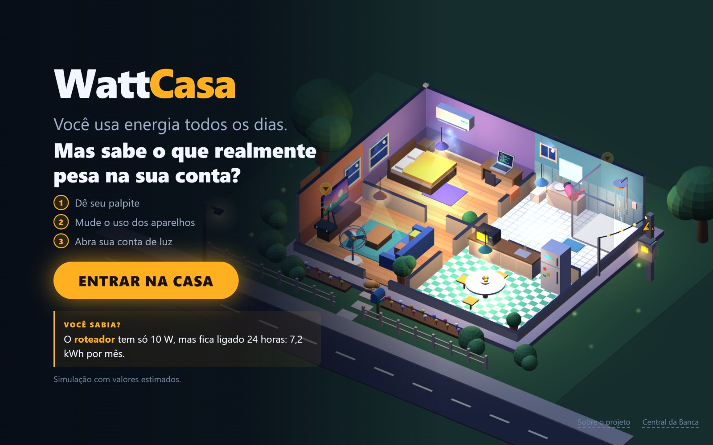
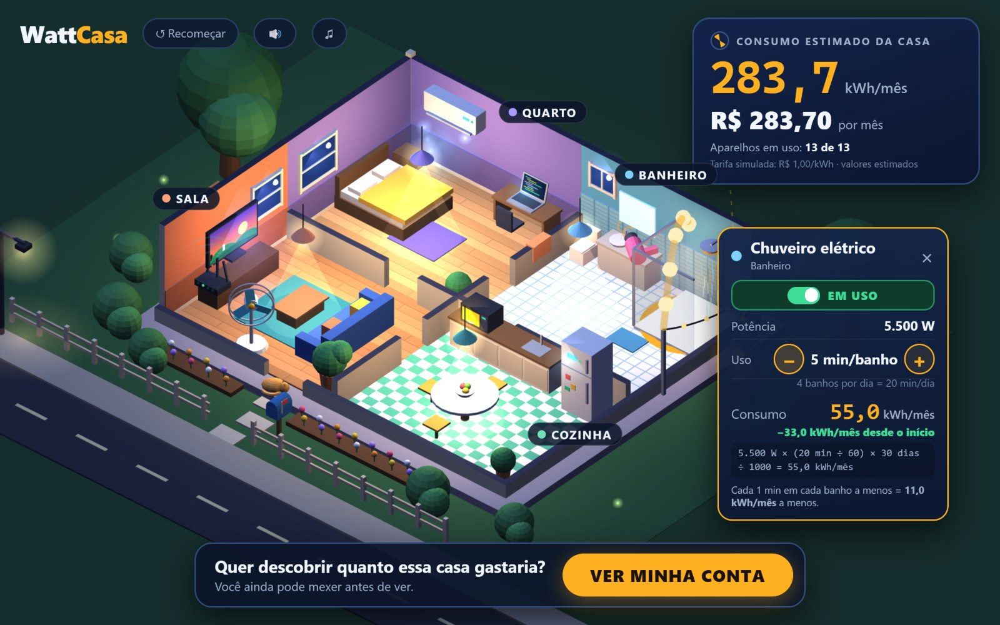
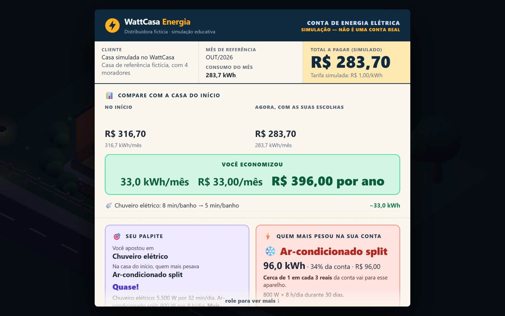
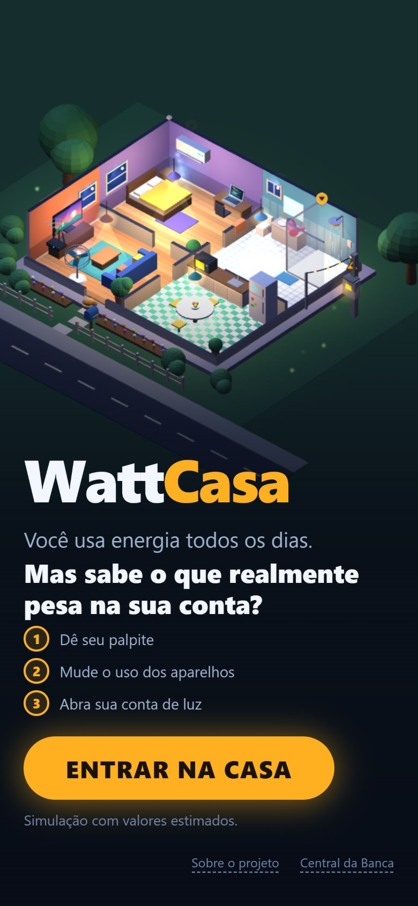
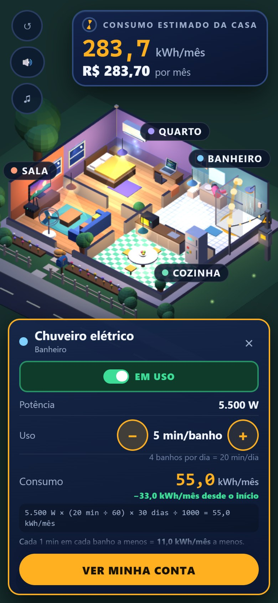
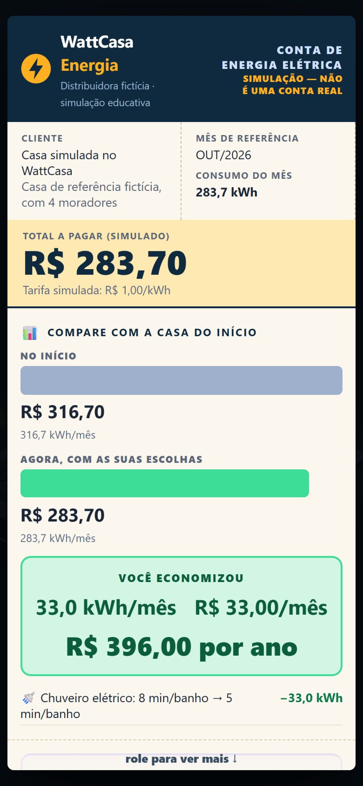

<div align="center">

# ⚡ WattCasa

**Mexa na casa, veja o que muda na conta.**

Simulação interativa em 3D que mostra, na prática, para onde vai a energia elétrica de uma residência.

Projeto acadêmico apresentado na **EXPOTEC 2026 — FORTEC**.

### [▶ Acessar a demonstração](https://pedroluccagarola.github.io/wattcasa/)



</div>

---

## Sobre o projeto

Muitas pessoas sabem que "o chuveiro gasta muito", mas não sabem quanto, nem que o **tempo de uso** pode pesar tanto quanto a **potência** de um aparelho. A WattCasa transforma essa ideia em uma experiência: em vez de uma calculadora, o visitante explora uma casa em 3D, altera o uso dos aparelhos e, ao final, recebe uma conta de luz simulada que explica o resultado.

A experiência tem três etapas:

1. **Palpite** — o visitante indica qual aparelho acredita ser o que mais pesa na conta.
2. **Exploração** — ao tocar em um aparelho, é possível ligá-lo, desligá-lo e ajustar o tempo de uso; o medidor de consumo reage imediatamente.
3. **Conta de luz** — um envelope é aberto e apresenta uma fatura simulada, com a resposta ao palpite, o comparativo "antes × depois", o consumo por cômodo e sugestões de economia calculadas a partir das escolhas feitas.

## Funcionalidades

- Casa térrea em 3D com quatro cômodos (quarto, banheiro, sala e cozinha) e 13 aparelhos interativos, cada um com animação própria quando ligado.
- Medidor de consumo em tempo real, em kWh/mês e em reais, com indicação da variação a cada mudança.
- Etiqueta de cada aparelho com potência, tempo de uso, consumo mensal e a fórmula utilizada no cálculo.
- Fatura simulada com: resultado do palpite, aparelho de maior impacto, comparação com a casa inicial, distribuição do consumo por aparelho e por cômodo, consumo contínuo (geladeira e roteador) e dicas de economia.
- Interface adaptada para computador, celular em pé e celular deitado, com zoom por roda do mouse ou gesto de pinça.
- Sons e música de fundo gerados pelo próprio navegador, sem arquivos de áudio.
- Modo feira: ao ser aberto localmente, retorna ao início após um período sem uso e mantém um placar diário de visitantes (armazenado apenas no navegador).
- Página **Sobre o projeto** e **Central da Banca**, que reúne fórmulas, hipóteses, fontes dos dados e limitações da simulação.
- Funciona sem internet: todos os arquivos, inclusive a biblioteca 3D, estão no repositório.

<table>
  <tr>
    <td align="center"><br><sub>Etiqueta do aparelho e medidor</sub></td>
    <td align="center"><br><sub>Conta de luz simulada</sub></td>
  </tr>
</table>

<table>
  <tr>
    <td align="center"><br><sub>Início (celular)</sub></td>
    <td align="center"><br><sub>Ajuste de uso (celular)</sub></td>
    <td align="center"><br><sub>Conta (celular)</sub></td>
  </tr>
</table>

## Como o consumo é calculado

Todos os valores exibidos são calculados por um único módulo (`js/calculo.js`) a partir dos dados de entrada do catálogo (`js/catalogo.js`). Nenhum valor em kWh ou em reais é digitado manualmente nas páginas.

| Caso | Fórmula |
|---|---|
| Aparelhos por tempo de uso | `kWh/mês = potência (W) × horas por dia × dias no mês × fator de funcionamento ÷ 1000` |
| Geladeira | consumo mensal de referência publicado (o compressor liga e desliga sozinho) |
| Custo | `R$ = kWh × tarifa` |

O ar-condicionado utiliza um fator de funcionamento de 50%, pois o compressor não permanece ligado o tempo todo. A tarifa adotada é de **R$ 1,00/kWh**, um valor didático escolhido para facilitar a leitura dos resultados. As potências e os tempos de uso têm origem em tabelas publicadas (CEMIG, Eletrobras e Equatorial), e cada número possui uma indicação de status (*estimado* ou *hipótese*) e de fonte, apresentadas na Central da Banca.

## Tecnologias utilizadas

- **HTML5 e CSS3** — estrutura e layout responsivo, sem frameworks.
- **JavaScript** (sem bibliotecas adicionais e sem etapa de compilação).
- **[Three.js](https://threejs.org/) r128** — renderização da casa em 3D com WebGL; as texturas são desenhadas por código com a API Canvas 2D.
- **Web Audio API** — efeitos sonoros e música de fundo sintetizados no navegador.
- **localStorage** — placar diário do modo feira.
- **GitHub Pages** — publicação da demonstração.
- **Testes automatizados** do cálculo, executáveis no navegador e no Node.js.

## Estrutura do repositório

```
wattcasa/
├── index.html          # experiência principal (casa 3D)
├── sobre.html          # apresentação do projeto
├── banca.html          # Central da Banca: fórmulas, fontes e auditoria dos valores
├── css/wattcasa.css    # estilos e adaptação para celular
├── js/
│   ├── catalogo.js     # dados de entrada dos aparelhos e suas fontes
│   ├── calculo.js      # fórmulas de consumo, custo e arredondamento
│   ├── estado.js       # etapas da experiência e estado da casa
│   ├── cena3d.js       # construção e animação da casa em 3D
│   ├── interface.js    # medidor, etiquetas, convites e conta de luz
│   ├── musica.js       # música de fundo gerada pelo navegador
│   └── placar.js       # placar diário do modo feira
├── libs/three.min.js   # biblioteca Three.js (cópia local)
├── assets/             # imagens usadas na página "Sobre"
├── tests/              # testes do cálculo
└── docs/               # capturas de tela e material de divulgação
```

## Como executar localmente

O projeto não possui dependências a instalar.

1. Clone o repositório:
   ```bash
   git clone https://github.com/pedroluccagarola/wattcasa.git
   cd wattcasa
   ```
2. Inicie um servidor local na pasta do projeto. Por exemplo, com Python:
   ```bash
   python -m http.server 8000
   ```
   ou com Node.js:
   ```bash
   npx serve .
   ```
3. Acesse `http://localhost:8000` no navegador.

Também é possível abrir o arquivo `index.html` diretamente no navegador; nesse caso, a aplicação entra no **modo feira** (retorno automático ao início e placar de visitantes).

Para executar os testes do cálculo:

```bash
node tests/testes.js
```

ou abra `tests/calculo.html` no navegador.

## Equipe

| Papel | Integrantes |
|---|---|
| Desenvolvimento | Pedro Lucca |
| Ideias e apresentação na EXPOTEC | Caio, Daniel, Felipe, João, Lucas, Luiz, Miguel e Yasmin |

### Minha contribuição

Desenvolvi sozinho todo o software da WattCasa: a casa em 3D, os cálculos, a interface, os testes e a publicação no GitHub Pages, utilizando o Claude como principal ferramenta de desenvolvimento. A equipe contribuiu com ideias e com a apresentação na EXPOTEC.

## Como foi desenvolvido

O código foi escrito com inteligência artificial (**Claude**, da Anthropic) como principal ferramenta de desenvolvimento. Coube a mim definir a experiência e as prioridades do projeto, nesta ordem: cálculos corretos, depois funcionamento e, por fim, visual. Também conduzi cada etapa do desenvolvimento, testei a aplicação, identifiquei os erros e tomei as decisões do projeto.

## Aviso

> Os valores apresentados pela WattCasa são **estimativas educativas**. A casa é fictícia, a tarifa é didática e as potências correspondem a aparelhos típicos, não a modelos específicos. Bandeiras tarifárias, impostos, consumo em espera (*stand-by*) e outros fatores não são considerados. A simulação não representa a residência do usuário nem uma conta de energia real.
